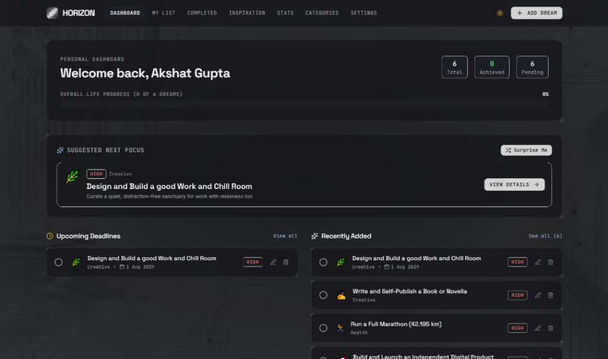
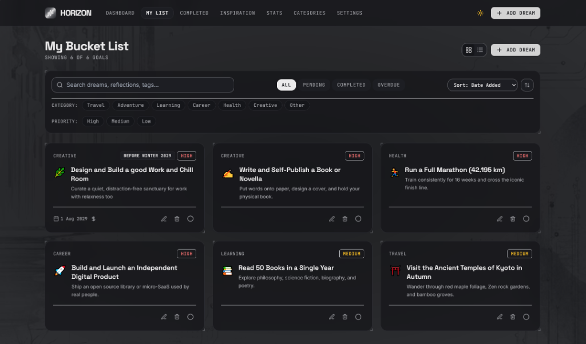
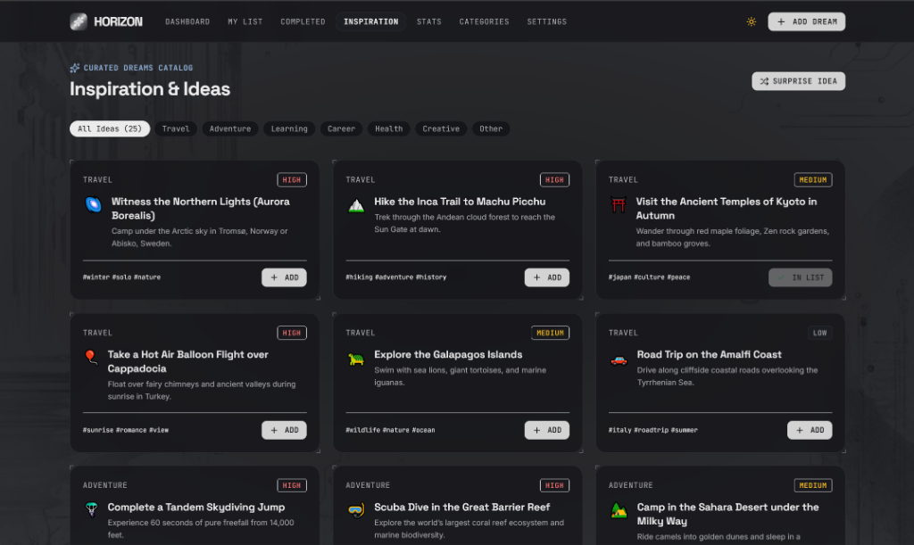
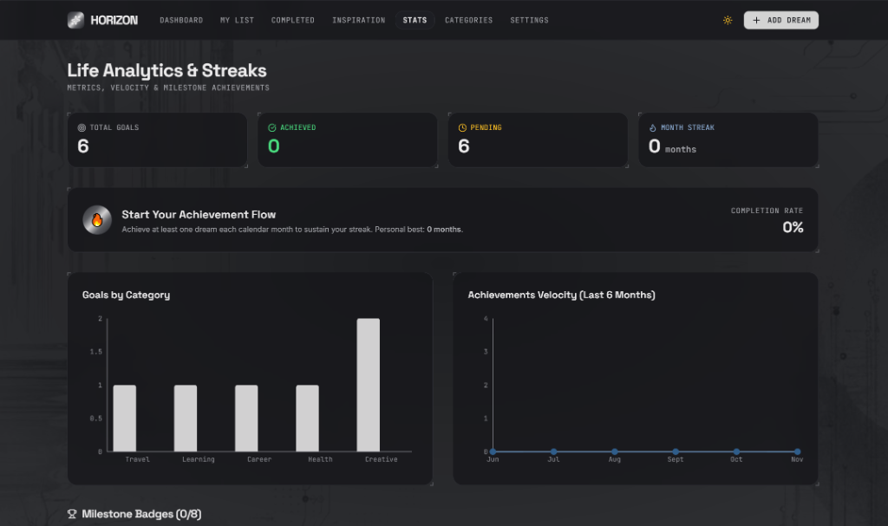

# HORIZON

> **A quiet, high-end sci-fi interface for your life's greatest aspirations.**  
> Client-only web application · Zero-database localStorage persistence with corruption recovery · Chrome visual theme

---

## 🌌 Overview

**HORIZON** is a personal bucket list web application built with **React 19**, **TypeScript**, and **Tailwind CSS**. Users capture dreams, plan sub-tasks and budgets, categorize life priorities, track achievement velocity, and preserve completed memories with reflections.

All data is stored **strictly inside the browser's localStorage** — no cloud databases, no account signups, zero tracking, and zero third-party network requests.

---

## 📸 Interface Preview

*Click any screenshot to open the full uncompressed high-resolution view.*

### 1. Personal Dashboard
> Real-time life progress tracking, quick metrics, "Suggested Next Focus" recommendation engine, and dual-column feeds for upcoming deadlines and recently added dreams.

[](./docs/screenshots/dashboard.png)

### 2. My Bucket List (Interactive Grid & Filters)
> Fluid grid/list view toggle, debounced search across titles, notes, and tags, multi-filter pills for categories and priorities, and quick status tabs (All, Pending, Completed, Overdue).

[](./docs/screenshots/my-list.png)

### 3. Curated Inspiration Catalog
> Explore 25 curated dream templates across 6 core domains. Features a 1-click "+ ADD" button, instant duplicate detection (`✓ IN LIST`), and a "Surprise Idea" randomizer.

[](./docs/screenshots/inspiration.png)

### 4. Life Analytics & Streaks
> Interactive Recharts visualizations showcasing category distributions and 6-month completion velocity, alongside monthly streak trackers and milestone achievements.

[](./docs/screenshots/stats-analytics.png)

---

## 🗺️ Pages & Features

| Route | Page | Key Features |
|---|---|---|
| `/#/` | **Dashboard** | Life progress bar, upcoming deadlines, recently added goals, "Do This Next" recommendation, and "Surprise Me" randomizer. |
| `/#/list` | **My Bucket List** | Grid and list view toggle, debounced search (matches title, description, tags), multi-category and multi-priority filters, status tabs (All, Pending, Completed, Overdue), and URL query state sync. |
| `/#/add`, `/#/edit/:id` | **Add / Edit Goal** | Validated form with React Hook Form + Zod, emoji selector with quick palette, category dropdown with inline category creator, target date, horizon tags, and budget estimator. |
| `/#/item/:id` | **Item Details** | Full notes, interactive sub-tasks checklist, budget progress meter, memory reflection card, and meta timestamps. |
| `/#/completed` | **Memories & Timeline** | Achieved dreams stream grouped chronologically by year and month with reflection quotes. |
| `/#/categories` | **Categories Manager** | Category cards with item counts and progress bars, add custom categories, rename, and safely delete with automated goal reassignment to "Other". |
| `/#/explore` | **Inspiration Catalog** | 25 curated dreams across 6 categories with 1-click "Add to List" and duplicate detection. |
| `/#/stats` | **Stats & Analytics** | Lazy-loaded Recharts visualizations (category distribution, monthly completion velocity), consecutive calendar month streak counter, derived milestone badge shelf, and screen reader accessible data table. |
| `/#/settings` | **Settings** | Display name, theme selector (System / Light / Dark), default view mode, currency code (INR, USD, EUR, GBP, etc.), storage capacity meter, JSON export, import with Replace or Merge, and typed confirmation reset (`"DELETE"`). |
| `*` | **404** | Atmospheric "Signal Lost in Orbit" recovery screen with quick return links. |

---

## ⚡ Tech Stack

- **UI Framework**: React 19 (strict mode)
- **Language**: TypeScript (strict type checking enabled)
- **Bundler**: Vite 6
- **Styling**: Tailwind CSS v3.4 + PostCSS with semantic CSS variables
- **Routing**: `react-router-dom` using `createHashRouter` for zero-configuration static hosting (GitHub Pages, Vercel, Netlify, Cloudflare Pages)
- **State Management**: Zustand store with debounced writes (300ms) and immediate flush on `visibilitychange` or `pagehide`
- **Validation**: Zod (single source of truth for schemas, types, and environment variables)
- **Forms**: React Hook Form with `@hookform/resolvers/zod`
- **Charts**: Recharts (code-split and lazy-loaded on `/stats`)
- **Celebration Effects**: `canvas-confetti` (disabled under reduced motion)
- **Testing**: Vitest + React Testing Library + jsdom

---

## 🚀 Getting Started

### Prerequisites
- Node.js (Active LTS v20+ or v22+, verified on Node v24)
- npm v10+

### Installation
```bash
npm install
```

### Development Server
```bash
npm run dev
```
Open [http://localhost:5173/#/](http://localhost:5173/#/) in your browser.

### Run Unit Tests
```bash
npm test
```

### Production Build
```bash
npm run build
```
Builds optimized, code-split static assets in `dist/`.

---

## 🛡️ Data Safety & Persistence Engine

| Safeguard | Implementation |
|---|---|
| **Atomic Saves** | Entire application state is serialized under key `horizon:v1`. Saves are debounced by 300ms and flushed synchronously on document hide. |
| **Corruption Recovery** | If unreadable or corrupted JSON is detected, the raw data is safely preserved in `horizon:v1:corrupt-<timestamp>`, clean defaults are initialized, and a persistent banner offers immediate download of the corrupt string. |
| **Quota Overflow Protection** | Catches `QuotaExceededError` without crashing, keeps state active in memory, and alerts the user to export a backup. |
| **Memory-Only Fallback** | Runs gracefully in-memory with a top warning banner when browser storage is blocked or restricted (e.g. private browsing). |
| **Cross-Tab Synchronization** | Real-time state updates across multiple browser tabs via the window `storage` event. |
| **Export & Import** | Full backup download (`horizon-backup-YYYY-MM-DD.json`). Import validates against Zod schemas, enforces a 5MB size limit, and supports **Replace** or **Merge** (conflict resolution by newer `updatedAt`). |
| **Typed Reset Confirmation** | Complete data wipe requires explicitly typing `"DELETE"` in the modal dialog. |

---

## 🔒 Security & Privacy Standard

- **No Remote Transmission**: Goals, reflections, notes, and budgets never leave the local device.
- **XSS Prevention**: User content is strictly rendered as React text nodes. Zero usage of `dangerouslySetInnerHTML` or `innerHTML`.
- **Zero Secrets**: No sensitive keys in source or client environment variables.
- **Recommended Content Security Policy (CSP)** for static hosting:
  ```http
  Content-Security-Policy: default-src 'self'; img-src 'self' data:; style-src 'self' 'unsafe-inline' https://fonts.googleapis.com; font-src 'self' https://fonts.gstatic.com; script-src 'self'; object-src 'none'; frame-ancestors 'none';
  ```

---

*HORIZON. Quiet interface, loud dreams, your data on your device.*
